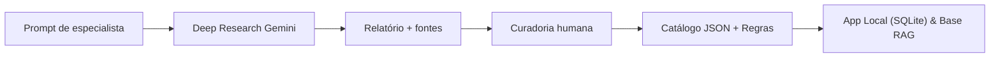
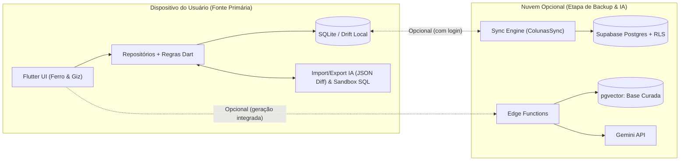

# PRD Mestre — Caramelo Mutante (App de Treino e Dieta Personalizado)

**Versão:** 2.0 · Nov 2026  
**Autor:** @Kleber Wendel Melo do Nascimento  
**Documentos do Produto:**
- **PRD Mestre (este documento):** Visão geral, posicionamento Local-First, sistema de marca *Ferro & Giz*, onboarding, anamneses clínica/nutricional, base científica (Deep Research), inteligência híbrida e segurança/LGPD.
- **[PRD do Módulo de Treino](./PRD_Modulo_Treino.md):** Arquitetura detalhada de UX/UI, navegabilidade das 4 abas, fluxos de pré-treino e chão de academia, construtor completo de ficha, regras determinísticas de alteração, protocolo de portabilidade para qualquer IA e evolução do esquema SQLite/Drift.

---

## 1. Visão geral e posicionamento

O **Caramelo Mutante** é um aplicativo **Local-First** de musculação e nutrição personalizada que une autonomia total na academia (execução rápida, edição livre de fichas e soberania sobre os próprios dados em SQLite) com inteligência baseada em evidências científicas.

**Problema.**
1. Planos genéricos ignoram histórico, lesões, rotina, equipamentos reais e orçamento alimentar, gerando abandono nas primeiras semanas.
2. No extremo oposto, apps "100% guiados por IA na nuvem" prendem o praticante numa caixa-preta: exigem login e dezenas de perguntas antes do primeiro uso, não deixam ajustar pesos ou fichas rapidamente antes do treino, falham sem sinal de internet na academia e geram custo recorrente de API.

**Princípios inegociáveis do produto**
- **Local-First Soberano:** O banco SQLite local no aparelho é a fonte primária da verdade. O app funciona 100% offline, sem exigir criação de conta ou login, e permite exportar/importar tudo (JSON estruturado para IAs externas, `.sql` e `.sqlite`).
- **Autonomia Real + IA sob Demanda:** Quem já treina entra em menos de 45 segundos (colando ficha de qualquer IA ou escolhendo/montando a própria ficha). Quem quer orientação guiada usa a anamnese progressiva e o motor de recomendação.
- **Inteligência Híbrida ("Bring Your Own AI" + Motor Gemini/RAG):** Na fase local/gratuita, qualquer usuário pode exportar um pacote estruturado (ficha + histórico real + catálogo + prompt-guia) para ajustar seu treino em qualquer IA externa (ChatGPT, Claude, Gemini Web) e reimportar com validação e *diff* visual. Em nuvem opcional, o motor próprio roda em modelos Gemini com RAG sobre base científica curada.
- **Segurança Clínica por Regra Fixa:** Triagens de risco (PAR-Q+ e comportamento/clínica alimentar) rodam em código determinístico, encaminhando a profissionais de saúde quando houver sinal de alerta.

**Objetivos do produto**
- Permitir começar o primeiro treino em **menos de 45 segundos** (via rápida) ou entregar um plano personalizado por anamnese em **até 5 minutos**.
- Reduzir o tempo gasto olhando para a tela na academia: preparação pré-treino antes de iniciar o cronômetro e registro de série em **1 toque**.
- Ajustar e sugerir progressão de cargas com base em registros reais (carga, repetições, RIR e recordes pessoais).
- Basear recomendações automatizadas em uma base de conhecimento versionada e com fontes científicas rastreáveis (ACSM, NSCA, ISSN, TBCA/TACO).

**Não-objetivos (v1)**
- Não substitui nutricionista, médico ou profissional de educação física; não faz diagnóstico clínico nem prescreve dietas terapêuticas.
- Não trata modalidades além de musculação e condicionamento complementar.
- Não integra com balanças inteligentes ou *wearables* na v1.

---

## 2. Identidade de marca e Design System: Ferro & Giz (Ferro Vivo)

A interface e a comunicação seguem o sistema de marca **Caramelo Mutante — Ferro & Giz (Folha 01)** e o manifesto **Ferro Vivo** (*"uma forma viva, construída com a disciplina do ferro"*).

### 2.1. Princípios visuais e sensoriais
- **Campo escuro por subtração:** O espaço é predominantemente ferro fosco escuro (`Ferro 900` e `Ferro 800`). Sem degradês, sem sombras projetadas (*drop shadows*) e sem brilhos artificiais: a profundidade nasce apenas da ordem das camadas sólidas e de bordas finas de 1 px (`Ferro 700`).
- **Brasa pontual e dominante:** Uma única cor quente (`Brasa #FF5A1F`) ocupa pouca área e indica exclusivamente a ação principal da tela, a série ativa ou o progresso em curso.
- **Giz cirúrgico:** O tom claro e seco (`Giz #F0EAE3`) aparece onde a leitura exige contraste imediato (números de carga/repetições, cronômetro e títulos).
- **Composição de prancha técnica & contenção textual:** Hierarquia brutalmente clara — primeiro o número/forma, depois o nome do exercício, por último anotações técnicas monoespaçadas. Textos curtos, diretos, sem frases prolixas nem tom professoral ou punitivo.
- **Símbolo e assinatura:** A cabeça assimétrica do Caramelo Mutante (uma orelha em pé, uma orelha caída como quebra intencional da grade de 8, e a listra nasal subindo como seta de progresso) deve permanecer legível até 16 px.

### 2.2. Paleta oficial de cores (Folha 01)

| Token | Hex | Papel na interface |
| :--- | :--- | :--- |
| `ferro900` | `#0F0F11` | Fundo principal das telas |
| `ferro800` | `#1B1B1F` | Cartões, barra inferior e painéis (*bottom sheets*) |
| `ferro700` | `#23262B` | Botões `−/+`, *chips* inativos e linhas divisórias |
| `ferro400` | `#878C93` | Rótulos técnicos, metadados e texto secundário |
| `giz` | `#F0EAE3` | Números de destaque, títulos e texto primário |
| `brasa` | `#FF5A1F` | Ação primária, seleção ativa e anel de descanso |
| `avanco` | `#46D39A` | Novo PR, série concluída dentro/acima da meta |
| `atencao` | `#F2B33D` | Aquecimento, valor editado fora do plano, sugestão de carga menor |
| `dor` | `#E5484D` | Ações destrutivas e alertas de dor/restrição |

### 2.3. Tipografia estrutural e grade
- **Grade espacial:** Múltiplos estritos de `8 pt` (`4`, `8`, `12`, `16`, `24`, `32`).
- **Famílias tipográficas:**
  - `BigShoulders` (Display condensada pesada, peso de barra carregada): cargas, repetições, cronômetro e títulos de sessão.
  - `InstrumentSans` (Neo-grotesca limpa): nomes de exercícios, botões e corpo funcional.
  - `GeistMono` (Monoespaçada em caixa alta espaçada, como gravação a laser no aço): rótulos técnicos (`SEMANA 2 DE 6`, `SÉRIE 1 DE 3`, `PR ATUAL`).

---

## 3. Personas, papéis e onboarding de duas vias

Cada instalação mantém perfil, planos e histórico 100% isolados no dispositivo (e, quando sincronizados na nuvem, protegidos por Row Level Security por usuário).

| Persona | Contexto | O que precisa do Caramelo Mutante |
| :--- | :--- | :--- |
| **Iniciante** | Nunca treinou ou parou há mais de 1 ano | Templates seguros ou anamnese guiada, execução clara, progressão conservadora |
| **Intermediário** | Treina de 1 a 3 anos, quer sair do platô | Controle fino de carga/RIR, pré-treino rápido, volume semanal por músculo, modo PR |
| **Avançado** | Treina há > 3 anos, ficha própria ou consultoria | Editor completo (bi-sets, drop-set/rest-pause, exercícios próprios), portabilidade IA e SQL |
| **Rotina corrida** | Academia cheia em horário de pico | Ordem livre de exercícios, botão "Aparelho ocupado" em 1 toque, ajuste prévio de cargas |
| **Profissional (fase futura)** | Personal ou nutricionista com alunos | Revisão/aprovação de fichas e acompanhamento mediante convite aceito |

### 3.1. Onboarding relâmpago (< 45 segundos)
Para evitar abandono antes do primeiro treino, a anamnese longa **não bloqueia** a entrada no app. Na primeira abertura, uma única tela coleta o **Nome/Apelido** (salvo localmente) e oferece **3 portas imediatas**:
1. **Colar ficha de IA / Importar:** Abre direto o validador para colar um treino gerado no ChatGPT/Claude/Gemini ou restaurar backup `.sql`/`.sqlite`.
2. **Escolher template ou montar do zero:** Oferece divisões clássicas editáveis (*Full Body*, *Upper/Lower*, *ABC Push/Pull/Legs*) ou abre o Construtor de Ficha limpo.
3. **Responder anamnese guiada:** Inicia a triagem de segurança (Bloco A) + perguntas essenciais para geração assistida do plano.

---

## 4. Arquitetura global de navegação

Enquanto o módulo de Dieta estiver em fase futura, a barra inferior exibe **apenas abas 100% funcionais** (sem itens desabilitados ocupando área nobre de toque):

| Ordem | Aba | Responsabilidade Central |
| :--- | :--- | :--- |
| **1** | **Hoje** | Cabeçalho com identidade (`NOME · SEMANA · FICHA`), pulso de frequência da semana, seletor de sessão (`A`, `B`, `C` com permissão de treinar fora da ordem), preparação pré-treino (alterar cargas, ativar aquecimento/PR ou trocar exercício antes de iniciar) e disparo da execução. |
| **2** | **Ficha** | Visão macro da divisão ativa (volume semanal por grupo muscular e duração estimada), gestão de múltiplas fichas, **Editor Completo de Ficha** (dias, exercícios customizados, bi-sets, técnicas, notas de setup) e **Central Portável de IA** (*Copiar pacote p/ IA* e *Colar resposta com Diff*). |
| **3** | **Evolução** | Painel Geral de Resumo do Atleta: consistência semanal/mensal, séries por músculo, tonelagem real, evolução de carga/1RM estimado, quadro de PRs, peso corporal simples e histórico cronológico de treinos passados (com edição/correção retroativa). |
| **4** | **Perfil** | Cartão de identidade do atleta (nome, peso, objetivo), configuração da academia (peso da barra, incremento mínimo), preferências de progressão (`sugestaoCargaMenor`, `modoNovoZero`), exportação/importação **`.sql` e `.sqlite` com sandbox** e backup opcional em nuvem. |

> O detalhamento completo de telas, estados, fluxos de execução e regras de alteração do treino encontra-se no **[PRD do Módulo de Treino](./PRD_Modulo_Treino.md)**. Quando o Módulo de Dieta for lançado (Fase 3), ele ingressará na navegação sem comprometer o fluxo de 1 toque do treino.

---

## 5. Anamnese de musculação (fluxo guiado sob demanda)

Usada na porta 3 do onboarding ou ao solicitar geração/revisão assistida de plano. Possui 7 blocos (~35 perguntas), com salvamento parcial. Os blocos A, C e E formam o núcleo rápido; os demais refinam a prescrição progressivamente.

**Bloco A — Triagem de segurança (obrigatório na geração assistida, baseado no PAR-Q+)**
1. Algum médico já disse que você tem problema cardíaco ou pressão alta? (T)
2. Sente dor no peito em repouso, no dia a dia ou durante esforço? (T)
3. Já perdeu o equilíbrio por tontura ou desmaiou nos últimos 12 meses? (T)
4. Tem alguma condição crônica diagnosticada além de cardíaca ou de pressão (diabetes, asma, doença renal, outras)? (T + texto)
5. Usa medicamentos de uso contínuo? Quais?
6. Tem problema ósseo, articular ou de tecido mole que possa piorar com exercício? Onde? (T + mapa corporal)
7. Fez cirurgia nos últimos 12 meses? Qual e quando?
8. Está gestante ou no pós-parto (até 12 meses)? (T)
9. Algum médico já recomendou que você só faça exercício com supervisão? (T)

> **Regra determinística:** Qualquer "sim" nas perguntas 1, 2, 3, 8 ou 9 bloqueia a geração automática de plano de intensidade e exibe orientação acolhedora para liberação médica (o uso manual do diário de treino segue sob responsabilidade do usuário, mediante ciência). As demais geram filtros automáticos de exercícios contraindicados.

**Bloco B — Dados básicos**
1. Data de nascimento, sexo, altura, peso atual.
2. Circunferências opcionais (fase Dieta/Avaliação): cintura, quadril, braço, coxa.
3. Percentual de gordura estimado, se souber, e método (bioimpedância, dobras, DEXA). (T)
4. Fotos de progresso opcionais (fase futura), armazenadas localmente ou em bucket privado criptografado.

**Bloco C — Objetivo**
1. Objetivo principal: hipertrofia, emagrecimento, força, recomposição corporal, saúde/condicionamento. (T)
2. Objetivo secundário, se houver. (T)
3. Meta concreta e prazo desejado.
4. Grupos musculares que deseja priorizar. (T, multi)

**Bloco D — Histórico de treino**
1. Tempo de musculação contínua (nunca / < 6 meses / 6–12 meses / 1–3 anos / > 3 anos). (T)
2. Treina atualmente ou parou há quanto tempo? (T)
3. Divisão atual (Full Body, AB, ABC, ABCD, Upper/Lower, Push/Pull/Legs, outra). (T)
4. Cargas atuais aproximadas em básicos (supino, agachamento, terra, remada — opcional).
5. Outras atividades físicas na semana (frequência e intensidade).
6. Autoavaliação técnica nos exercícios básicos (1 a 5). (T)

**Bloco E — Disponibilidade e ambiente**
1. Dias disponíveis por semana (2 a 6). (T)
2. Tempo disponível por sessão (30 / 45 / 60 / 75 / 90+ min). (T)
3. Horário habitual de treino. (T)
4. Local: academia completa, academia de condomínio, casa, ao ar livre. (T)
5. Equipamentos disponíveis (halteres, barra, anilhas, máquinas, polia, elásticos, banco, barra fixa, kettlebell).

**Bloco F — Lesões, dores e limitações**
1. Regiões com dor atual ou lesão prévia.
2. Intensidade (0–10), movimentos que agravam e se está em tratamento.
3. Padrões evitados (agachar fundo, elevar acima da cabeça, apoio de punho etc.). (T, multi)

**Bloco G — Recuperação e preferências**
1. Horas e qualidade percebida de sono (1–5).
2. Estresse diário e tipo de trabalho (sentado, em pé, braçal). (T)
3. Exercícios favoritos e exercícios que detesta.
4. Preferência por técnicas avançadas (bi-set, drop-set, rest-pause — intermediário/avançado). (T)

---

## 6. Anamnese nutricional e Módulo de Dieta (Fase 3)

Reaproveita peso, altura, idade, sexo, objetivo e rotina já informados no perfil. O Bloco A é obrigatório antes de qualquer cálculo calórico.

**Bloco A — Segurança clínica e alimentar (obrigatório)**
1. Condição clínica que exija dieta específica (diabetes, doença renal, hepática, intestinal, hipertensão, dislipidemia)? (T + texto)
2. Alergias ou intolerâncias alimentares e gravidade? (T + texto)
3. Acompanhamento atual com nutricionista ou médico? (T)
4. Medicamentos que afetam apetite, glicemia ou peso? (T + texto)
5. Triagem validada de comportamento alimentar (questionário SCOFF, 5 perguntas sim/não).
6. Gestante ou lactante? (T)

> **Regra determinística:** Condição clínica específica, gestação/amamentação ou SCOFF positivo bloqueiam geração de déficit calórico e metas de perda de peso, exibindo orientações qualitativas gerais (Guia Alimentar Brasileiro) e recomendação acolhedora de acompanhamento nutricional.

**Blocos B a G (coleta progressiva no módulo de Dieta)**
- **Bloco B — Rotina alimentar:** Número/horários de refeições, recordatório 24h guiado, beliscos, local das refeições e tempo de preparo.
- **Bloco C — Preferências:** Padrão alimentar (onívoro, vegetariano, vegano, pescetariano), restrições culturais/religiosas, aversões, alimentos favoritos e nível de repetição de cardápio.
- **Bloco D — Hidratação e hábitos:** Água diária, café/estimulantes/refrigerantes, álcool, horários de pico de fome.
- **Bloco E — Digestão e sinais:** Funcionamento intestinal (escala de Bristol), desconfortos pós-prandiais e curva de energia no dia.
- **Bloco F — Suplementação:** Uso atual e interesse em suplementos com nível A de evidência (creatina, whey, cafeína).
- **Bloco G — Contexto prático:** Faixa de orçamento mensal, região do país (alimentos sazonais/regionais), acesso a marmita e método preferido de controle (cardápio fechado, porções visuais ou contagem de macros).

---

## 7. Base de conhecimento científica: pipeline de Deep Research

A inteligência do app (tanto para enriquecer o catálogo embarcado quanto para o motor RAG futuro) baseia-se em 13 dossiês científicos gerados no Deep Research do Gemini e submetidos a curadoria humana antes de virar JSON/Markdown versionado.



| # | Pesquisa | Especialista simulado | Saída principal |
| :--- | :--- | :--- | :--- |
| 1 | Treino geral | Fisiologia do exercício e treinamento de força | Variáveis de volume, intensidade, divisões, progressão e deload |
| 2–12 | 11 Grupos musculares (Peitoral, Costas, Ombros, Bíceps/Braquial, Tríceps, Antebraço, Quadríceps, Posterior, Glúteos/Adutores, Panturrilhas, Core) | Biomecânica e anatomia funcional | Catálogo de exercícios, execução, erros, contraindicações, substitutos e volume ótimo |
| 13 | Nutrição avançada | Nutricionista esportivo | Equações energéticas, macros, suplementação nível A e mapeamento TBCA/TACO |

**Regras de curadoria**
- Priorizar revisões sistemáticas, meta-análises e posicionamentos oficiais (ACSM, ISSN, NSCA, Guia Alimentar Brasileiro).
- Registrar fonte e nível de evidência (`alto`, `moderado`, `baixo`) para cada recomendação; em divergências, adotar a margem mais conservadora para iniciantes.
- Tabela nutricional obtida exclusivamente das bases oficiais brasileiras (**TBCA/USP** e **TACO/Unicamp**), jamais estimada por LLM.

### 7.1. Prompt — Treino geral
```text
Atue como especialista em fisiologia do exercício e treinamento de força, com base em literatura científica.

Objetivo: produzir uma base de conhecimento para o app Caramelo Mutante, que gera e acompanha treinos de musculação personalizados.

Pesquise e sintetize, citando as fontes (priorize revisões sistemáticas, meta-análises e posicionamentos ACSM/NSCA de 2015 em diante):
1. Variáveis de treino: volume semanal por grupo muscular (séries), intensidade (%1RM, RPE, RIR), frequência, descanso entre séries, cadência, amplitude.
2. Recomendações por nível (iniciante, intermediário, avançado) e por objetivo (hipertrofia, força, emagrecimento, recomposição, saúde).
3. Divisões de treino (full body, AB, ABC, push/pull/legs, upper/lower): quando usar cada uma por dias disponíveis.
4. Modelos de progressão e periodização (linear, dupla progressão, ondulatória, blocos) e critérios de deload.
5. Aquecimento, ordem de exercícios e técnicas avançadas (drop-set, rest-pause, bi-set): eficácia e para quem.
6. Adaptações para idosos, gestantes (apenas diretrizes gerais), iniciantes sedentários e pessoas com dor lombar ou no ombro.
7. Sinais de overtraining e quando encaminhar a um profissional.

Formato da saída:
- Seções numeradas iguais às acima.
- Para cada recomendação: regra objetiva, faixa numérica, nível de evidência (alto/moderado/baixo) e fonte.
- Ao final, uma tabela-resumo: nível × objetivo × séries/semana × reps × RIR × descanso × frequência.
- Registre explicitamente onde as fontes divergem.
```

### 7.2. Prompt — Modelo por grupo muscular (rodar para os 11 grupos)
```text
Atue como especialista em biomecânica e treinamento de [GRUPO MUSCULAR], com base em literatura científica e em anatomia funcional.

Objetivo: criar a base de exercícios de [GRUPO MUSCULAR] ([SUBDIVISÕES]) para o app Caramelo Mutante.

Pesquise e entregue:
1. Anatomia funcional resumida: origem, inserção, ações, porções e como enfatizar cada uma.
2. Lista de 15 a 25 exercícios, cobrindo academia, casa (halteres/elásticos) e peso corporal. Para cada exercício:
   - nome em português e em inglês; músculos primários e secundários;
   - padrão de movimento; equipamento; modalidade de carga (bilateral, por_mao ou unilateral); nível mínimo;
   - passo a passo de execução (máx. 6 passos) e 3 erros comuns;
   - contraindicações e cuidados (ex.: dor no ombro, lombar, joelho);
   - 2 a 3 substitutos com o mesmo padrão de movimento;
   - faixa de repetições e tipo de estímulo em que ele rende melhor.
3. Volume semanal recomendado para esse grupo por nível, e frequência ideal.
4. Ordem sugerida dentro da sessão e combinações com outros grupos.
5. Evidência sobre exercícios mais eficazes para hipertrofia desse grupo, indicando limitações.

Formato da saída:
- Tabela de exercícios com as colunas: nome_pt | nome_en | primarios | secundarios | padrao | equipamento | modalidade_carga | nivel | contraindicacoes | substitutos | reps_ideais.
- Texto de execução e erros comuns em lista abaixo da tabela.
- Fontes e nível de evidência para cada recomendação numérica.
```

### 7.3. Prompt — Nutrição avançada e mapeamento TBCA/TACO
```text
Atue como nutricionista esportivo com domínio de nutrição baseada em evidências e do contexto alimentar brasileiro.

Objetivo: criar a base nutricional do app Caramelo Mutante para praticantes de musculação.

Parte 1 — Diretrizes (cite fontes: ISSN, ACSM, Academy of Nutrition and Dietetics, DRIs/IOM, Guia Alimentar para a População Brasileira):
1. Fórmulas de gasto energético (Mifflin-St Jeor, Harris-Benedict, Cunningham, Katch-McArdle): quando usar cada uma e fatores de atividade.
2. Déficit e superávit seguros por objetivo, velocidade máxima recomendada de perda/ganho de peso.
3. Proteína (g/kg), carboidratos e gorduras por objetivo e volume de treino; distribuição ao longo do dia e em torno do treino.
4. Hidratação, fibras, micronutrientes críticos para quem treina.
5. Suplementos com evidência forte (creatina, cafeína, whey, entre outros): dose, segurança e contraindicações; suplementos sem evidência.
6. Adaptações para vegetarianos e veganos.
7. Situações em que o app NÃO deve prescrever e deve encaminhar a um profissional.

Parte 2 — Tabela nutricional:
- Mapear os 300 alimentos mais consumidos no Brasil por região a partir das planilhas oficiais da TBCA (USP/FoRC) e TACO (Unicamp), com medidas caseiras em gramas e grupos de equivalência de macronutrientes, sem nunca estimar números ausentes nas tabelas oficiais.
```

---

## 8. Inteligência híbrida: Portabilidade Aberta + Motor Gemini/RAG

O Caramelo Mutante opera em duas frentes complementares de IA:

### 8.1. Frente 1 — Protocolo Aberto "Bring Your Own AI" (MVP Local, Custo Zero)
Documentado em detalhes na Seção 6 do [PRD do Módulo de Treino](./PRD_Modulo_Treino.md):
1. **Pacote IA na aba `Ficha`:** O app exporta em 1 toque um pacote estruturado contendo *Prompt de instruções + Ficha ativa + Estatísticas reais dos últimos 30 dias (cargas, PRs, RIR médio, aderência) + Catálogo de exercícios*. O usuário cola em qualquer IA gratuita (ChatGPT, Claude, Gemini), pede alterações em linguagem natural e cola a resposta de volta. O app valida o JSON, cadastra exercícios novos se necessário e apresenta uma **tela de Diff Visual (Antes vs. Depois)** antes de gravar no SQLite.
2. **Acesso SQL/SQLite na aba `Perfil`:** Exportação e importação de `.sql` e `.sqlite` com validação em *sandbox* em memória e *snapshot* automático de restauração, permitindo auditoria avançada por IAs de análise de dados.

### 8.2. Frente 2 — Motor Integrado Gemini API + RAG (Fase Nuvem)
Quando o usuário optar pela geração integrada na nuvem:
- **Cálculos determinísticos no código:** Triagem clínica, TMB/GET, macros, arredondamento de anilhas/halteres, 1RM estimado (Epley) e progressão rodam 100% em Dart/código auditável — nunca delegados à aritmética do LLM.
- **System Instructions com *Structured Outputs*:**

```text
Você é o motor de planejamento de treino e alimentação do app Caramelo Mutante.
Use SOMENTE o conhecimento dos documentos curados fornecidos no contexto; se a informação não estiver lá, informe que não há base suficiente.
Você recebe: perfil anonimizado do usuário, restrições calculadas pelo sistema, lista de exercícios permitidos e lista de alimentos permitidos.
Nunca inclua exercícios ou alimentos fora das listas permitidas, exceto quando o schema explicitamente autorizar criação validada.
Nunca calcule calorias, macros ou progressão numérica: use os valores calculados pelo sistema.
Nunca faça diagnóstico clínico, nunca prescreva dieta terapêutica e nunca sugira medicamentos ou hormônios.
Se houver sinal de risco no perfil, retorne status "encaminhar" e uma mensagem acolhedora recomendando avaliação profissional.
Responda estritamente no JSON Schema fornecido, em português do Brasil, com justificativa objetiva e id da fonte para cada escolha.
```

---

## 9. Arquitetura técnica: Local-First + Sync Opcional



- **Stack definida:** App multiplataforma em **Flutter (Dart)** com gerenciamento de estado em **Riverpod**, navegação em **GoRouter** e persistência relacional em **Drift (SQLite)** com migrações versionadas (`drift_schemas/`).
- **Sincronização tolerante a offline (`ColunasSync`):** Todas as tabelas mutáveis do usuário possuem UUID v4 gerado no cliente, `atualizado_em`, `excluido_em` (*soft-delete*) e `sincronizado_em`, permitindo uso anos a fio sem conta e sincronização limpa caso o usuário ative o backup no Supabase.

---

## 10. Segurança, LGPD e limites clínicos

Dados corporais e de saúde são dados pessoais sensíveis pela **LGPD (art. 11)**:
- **Privacidade por padrão (Local-First):** Sem login ativo, 100% dos dados permanecem exclusivamente no armazenamento local do dispositivo do usuário, sem telemetria identificável.
- **Consentimento granular (ao ativar nuvem/IA):** Consentimentos independentes para (a) backup em nuvem, (b) envio de perfil anonimizado (sem nome, e-mail ou fotos) ao motor de IA e (c) fotos corporais privadas.
- **Portabilidade e exclusão total:** Exportação completa (`.json`, `.sql`, `.sqlite`) e botão de limpeza definitiva local/remota disponíveis a qualquer momento na aba `Perfil`.
- **Linguagem sem culpa:** Proibição de termos punitivos (*"dia do lixo"*, *"pagar com cardio"*, alertas vermelhos por faltar treino). Pausas e treinos parciais são tratados como parte normal da rotina.

---

## 11. Métricas de sucesso, roadmap e riscos

### 11.1. Métricas-alvo
| Métrica | Meta |
| :--- | :--- |
| Tempo até iniciar o 1º treino (via rápida / template / IA) | ≤ 60 segundos |
| Tempo médio para registrar 1 série na academia | ≤ 2 segundos (1 toque) |
| Retenção de treino na semana 4 | ≥ 45% |
| Taxa de sucesso na validação de fichas coladas de IAs externas | ≥ 95% (com reparo/validação clara) |
| Zero perda de dados em segundo plano ou troca de ficha | 100% coberto por testes automatizados |

### 11.2. Roadmap consolidado (alinhado ao repositório `treino_app`)

| Etapa | Escopo Principal | Status |
| :--- | :--- | :--- |
| **Etapas 0–3** | Estrutura Flutter, tema *Ferro & Giz*, banco Drift v1–v3, tela Hoje inicial, execução de série, timer persistente, escala RIR, sugestão de carga menor, aquecimento e modo PR. | ✅ Concluído |
| **Etapa 4A — Navegação, Identidade & Pré-Treino** | Onboarding < 45s, barra de 4 abas ativas (`Hoje \| Ficha \| Evolução \| Perfil`), identidade do atleta, pulso da semana, treino fora da ordem e edição pré-treino de pesos/opções na `TelaHoje`. | Próxima |
| **Etapa 4B — Execução Flexível & Precisão** | Propagação de carga entre séries + promoção p/ ficha no resumo, Mapa da Sessão (ordem livre), botão "Aparelho ocupado", carga por mão/unilateral, Bi-sets e técnica na última série. | Planejada |
| **Etapa 4C — Aba `Ficha` & Portabilidade IA/SQL** | Visão macro de volume semanal por músculo, Editor Completo de Ficha, exercícios customizados, notas de setup, pacote copiar/colar p/ qualquer IA com *Diff* e Sandbox `.sql`/`.sqlite`. | Planejada |
| **Etapa 4D — Aba `Evolução` (Painel Geral)** | Resumo semanal/mensal, volume muscular realizado, gráficos de carga/1RM, quadro de PRs, peso corporal simples e histórico editável de treinos passados. | Planejada |
| **Etapa 5 — Backup & Sync Nuvem** | Autenticação opcional e sincronização incremental bidirecional com Supabase (RLS). | Fase 2 |
| **Etapa 6 — Base Científica Completa, Dieta & IA Nativa** | 13 Deep Research curados, tabela TBCA/TACO embarcada, módulo de Dieta, lista de compras e assistente RAG integrado. | Fase 3 |

### 11.3. Riscos e mitigações
| Risco | Mitigação |
| :--- | :--- |
| IA externa devolve JSON malformado ou IDs inexistentes | Parser tolerante a blocos Markdown + criação assistida de novos exercícios + tela obrigatória de *Diff Visual* antes de tocar no banco |
| Importação de `.sql` corrompe o SQLite local | Execução prévia em banco temporário em memória (`PRAGMA foreign_key_check` + `integrity_check`) + *snapshot* automático para reversão em 1 toque |
| Edição de ficha apaga ou distorce treinos passados | Séries congelam `carga_plan_kg`/`reps_plan` na hora do registro; trocas permanentes usam *soft-delete* (`excluido_em`) em `itens_plano` |
| Interface fica poluída com novas funções avançadas | Ações secundárias recolhidas em *bottom sheets* sob demanda; tela principal de série mantém apenas número gigante + registro em 1 toque |
