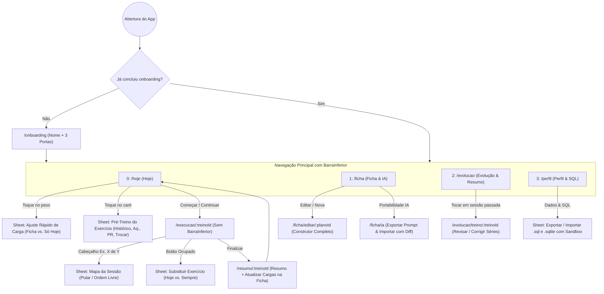

# PRD do Módulo de Treino — UX, Navegabilidade, Regras de Alteração e Portabilidade IA

**Produto:** Caramelo Mutante (`treino_app`)  
**Versão:** 2.0 · Nov 2026  
**Documento pai:** [PRD Mestre — Caramelo Mutante](./PRD_Mestre_Caramelo_Mutante.md)

---

## 1. Objetivo deste documento

Este PRD especifica em nível de engenharia e design de interação tudo o que governa o **Módulo de Treino** do Caramelo Mutante: onde cada informação mora na navegação, como preparar e alterar pesos **antes** e **durante** o treino sem perder tempo na academia, como editar fichas completas, como garantir integridade absoluta do histórico e dos PRs, e como operar a importação/exportação aberta para qualquer IA e via SQL.

### Diretrizes de UX de "Chão de Academia"
1. **Regra do Polegar Suado:** Toda ação frequente durante a sessão fica no terço inferior da tela, com alvo mínimo de toque de `48 × 48 dp` e espaçamento mínimo de `8 dp`.
2. **Preparar no vestiário, executar em 1 toque:** O usuário pode ajustar cargas, ativar aquecimento/modo PR, trocar exercícios e mudar o dia da divisão **antes** de iniciar o treino na aba `Hoje`. Durante a série, se fez o combinado, basta **1 toque** em `Registrar série`.
3. **Caminho não-linear real:** Academias lotam. O usuário nunca fica bloqueado esperando máquina: pode pular para outro exercício e voltar depois, substituir em 1 toque ou treinar outra letra da divisão no dia.
4. **Zero perda de estado:** Todo cronômetro (como `descanso_termina_em`), série confirmada ou ajuste temporário é persistido imediatamente no SQLite/Drift, sobrevivendo ao fechamento do app ou reinício do celular.

---

## 2. Alinhamento do Design System (*Ferro & Giz — Folha 01*)

Os tokens em [`lib/core/theme/tokens.dart`](../lib/core/theme/tokens.dart) devem refletir exatamente os hexadecimais homologados na Folha 01 do Sistema de Marca:

| Token em `Cores` | Valor Atual | Valor Oficial (Folha 01) | Uso Estrito |
| :--- | :--- | :--- | :--- |
| `ferro900` | `#0E0F11` | **`#0F0F11`** | Fundo de todas as telas (`Scaffold`) |
| `ferro800` | `#191B1F` | **`#1B1B1F`** | Cartões, `BarraInferior`, diálogos e *bottom sheets* |
| `ferro700` | `#23262B` | **`#23262B`** | Bordas de 1 px, divisórias, chips inativos, botões `−/+` |
| `ferro400` | `#878C93` | **`#878C93`** | Rótulos monoespaçados e textos de apoio |
| `giz` | `#EDEAE3` | **`#F0EAE3`** | Números principais, títulos e nomes de exercícios |
| `brasa` | `#FF5A1F` | **`#FF5A1F`** | CTA primário, aba/chip selecionado, série atual, timer |
| `avanco` | `#46D39A` | **`#46D39A`** | Recorde pessoal (PR), meta semanal concluída |
| `atencao` | `#F2B33D` | **`#F2B33D`** | Série de aquecimento, carga/sessão fora do padrão, sugestão de redução |
| `dor` | `#E5484D` | **`#E5484D`** | Exclusão e alertas críticos |

**Regras visuais obrigatórias (*Ferro Vivo*):**
- Proibido usar `BoxShadow`, gradientes lineares/radiais ou transparências esfumaçadas (*glassmorphism*).
- Hierarquia em 3 planos puros: número condensado (`BigShoulders`) → título funcional (`InstrumentSans`) → gravação técnica em caixa alta (`GeistMono`, `letterSpacing: 1.4`).

---

## 3. Arquitetura de informação e mapa de rotas (`GoRouter`)

A aba desabilitada `"Dieta (Em breve)"` é removida da [`BarraInferior`](../lib/core/widgets/barra_inferior.dart), dando lugar a **4 abas 100% ativas**:



### Estrutura da `BarraInferior`
| Índice | Rótulo | Ícone | Rota raiz |
| :--- | :--- | :--- | :--- |
| `0` | `HOJE` | `Icons.bolt` / `Icons.fitness_center` | `/hoje` |
| `1` | `FICHA` | `Icons.view_agenda_outlined` | `/ficha` |
| `2` | `EVOLUÇÃO` | `Icons.trending_up` / `Icons.show_chart` | `/evolucao` |
| `3` | `PERFIL` | `Icons.person_outline` | `/perfil` |

---

## 4. Especificação detalhada por tela e fluxo

### 4.0. Onboarding Relâmpago (`/onboarding` — < 45 segundos)
Exibido apenas quando `perfil_atleta.concluiu_onboarding == false`:
1. **Assinatura de topo:** Marca horizontal **Caramelo Mutante**.
2. **Campo único obrigatório:** `Como quer ser chamado?` (ex.: `Kleber`).
3. **Escolha seu ponto de partida (3 cartões tocáveis):**
   - **Colar treino de uma IA:** Abre direto a tela de importação IA (já com botão *"Copiar prompt modelo para pedir meu treino no ChatGPT/Claude/Gemini"* caso ainda não tenha gerado).
   - **Escolher base ou criar do zero:** Oferece 4 estruturas prontas (*ABC Push/Pull/Legs*, *Upper / Lower 4x*, *Full Body 3x*, *Ficha em branco*) e leva à `Hoje` ou ao `Editor`.
   - **Montar com anamnese guiada:** Abre o questionário de triagem (PAR-Q+) e perfilamento para montagem assistida.

---

### 4.1. Aba 1 — `Hoje` (`/hoje` — Identidade, Pulso e Pré-Treino)

Resolve três gargalos críticos atuais da [`TelaHoje`](../lib/features/hoje/tela_hoje.dart): falta de identidade, falta de resumo de ritmo semanal e impossibilidade de alterar pesos ou treinar outro dia antes de iniciar.

#### A. Cabeçalho de Identidade e Contexto
- Linha superior técnica: `[Selo 24px]  KLEBER · SEMANA 2 DE 6 · HIPERTROFIA ABC` (tocar no nome/selo navega para `Perfil`; tocar no nome da ficha navega para `Ficha`).

#### B. Faixa de Pulso da Semana (Resumo Rápido)
Cartão compacto em `ferro800` logo abaixo do cabeçalho:
- **Esquerda:** Indicadores visuais da meta semanal de sessões (`● ● ● ○  3 DE 4 NA SEMANA`). Se bateu a meta, os pontos ficam `avanco`.
- **Direita:** Volume acumulado na semana (`24,6 t`) e referência curta ao último treino (`Último: B · anteontem`).

#### C. Seletor de Dias da Divisão (`A`, `B`, `C`...) — Liberdade de Ordem
- A sessão sugerida para hoje (calculada a partir da última finalizada) recebe borda `brasa`.
- **Mudança de regra:** Ao tocar em uma sessão diferente da sugerida (ex.: hoje seria `A`, mas o usuário toca em `B`), o botão de ação inferior **NÃO desaparece**.
  - Exibe um rótulo discreto em `atencao`: `FORA DA SEQUÊNCIA · SUGERIDO HOJE: TREINO A`.
  - O botão inferior muda para **`Fazer Treino B hoje`** (e, se houver um `Treino A` já `em_andamento`, avisa que iniciar `B` pausará ou encerrará `A`).

#### D. Cartões de Exercício Interativos (Preparação Pré-Treino)
Cada cartão na lista de `Hoje` possui **duas zonas de toque independentes**:

1. **Zona Direita — Toque direto no Peso (`60 KG` ou `DEFINIR KG`):**
   Abre o *bottom sheet* **Ajuste Rápido de Carga Pré-Treino**:
   - Exibe `StepperValor` com botões `−/+` (respeitando `passo_carga_kg`) **e** toque no número central para digitar direto no teclado numérico.
   - Mostra referência imediata: `Última vez: 60 kg × 10, 10, 9 · PR: 65 kg`.
   - **Dois botões de confirmação (escopo explícito):**
     - **Primário (`Brasa`) — `Salvar na ficha`:** Atualiza `itens_plano.carga_plan_kg` permanentemente.
     - **Secundário (`Ferro 700`) — `Só hoje`:** Mantém a ficha intacta e grava um *override* pré-treino (`ajustes_pre_treino`) que será aplicado assim que a sessão iniciar (o peso aparece no card de `Hoje` em cor `atencao` com marcador `HOJE`).

2. **Zona Esquerda/Central — Toque no Nome/Prescrição do Exercício:**
   Abre o *bottom sheet* **Preparar Exercício**:
   - **Nota fixa de setup** editável em 1 linha (*"Banco furo 4 · Pegada pronada"*).
   - **Chaves de pré-ativação para hoje:**
     - `🔥 Série de aquecimento (~70%)` (já entra ligada ao iniciar o treino);
     - `📈 Tentar bater o PR (escada até 120%)`.
   - **Ação rápida:** `Aparelho ocupado / Trocar exercício` (com escolha *Só hoje* ou *Sempre na ficha*).
   - **Histórico recente:** Últimas 3 sessões daquele exercício.

*(Nota visual: se dois exercícios formam um **Bi-set**, seus cartões aparecem unidos por um conector lateral vertical com o selo `BI-SET A1 · A2`, e a `nota_setup` aparece em uma linha sutil abaixo da prescrição quando preenchida).*

---

### 4.2. Execução Imersiva (`/execucao/:treinoId` — Chão de Academia)

Evolui [`TelaSerie`](../lib/features/execucao/tela_serie.dart) e [`VistaDescanso`](../lib/features/execucao/tela_descanso.dart) preservando a limpeza visual de 1 toque.

#### A. Cabeçalho Clicável → Mapa da Sessão (Ordem Livre)
- Tocar no título central `TREINO A · EXERCÍCIO 2 DE 6 ▾` abre o *bottom sheet* **Mapa da Sessão**:
  - Lista todos os exercícios do dia com status (`✓ 3/3 concluído`, `● 1/3 agora`, `○ 0/3 pendente`).
  - Tocar em qualquer exercício não concluído **salta o foco imediatamente para ele** (`exercicio_foco_id` na sessão).
  - Quando todas as séries do exercício escolhido terminam, o app **retorna automaticamente para o primeiro exercício anterior que ficou pendente**, garantindo que nada seja esquecido antes de `Finalizar treino`.

#### B. Botão `"Aparelho ocupado"` na Execução
- Ao lado dos chips de `Aquecimento` e `Tentar bater o PR` (e no menu `⋯`), o chip/ação **`⇄ Ocupado`** abre a lista de substitutos:
  - **Topo da lista:** Exercícios do catálogo com o mesmo `padrao_movimento` (ex.: `empurrar-horizontal`), ordenados pelos que o usuário já tem histórico de carga.
  - **Busca rápida abaixo:** Permite escolher qualquer outro exercício do catálogo ou criar um novo na hora.
  - **Carga inicial inteligente:** Se o usuário já executou o exercício substituto antes, pré-preenche com a carga da `ultimaVez` dele; senão, deixa pronta para ajuste rápido.
  - **Escopo da troca:** Escolha em 1 toque entre **`Só neste treino`** (`escopo = 'sessao'`) ou **`Trocar na ficha`** (`escopo = 'sempre'`). Se o usuário já fez 1 série no aparelho antigo e trocou para terminar as 2 restantes em outro, as séries já feitas continuam salvas no exercício antigo e apenas as restantes migram para o novo!

#### C. Propagação de Carga Intra-Sessão + Promoção Pós-Treino
- **Regra durante o exercício:** Se a ficha prevê `60 kg` para 3 séries e na Série 1 o usuário altera para `65 kg` (via `✎ Alterar` antes de registrar ou `Ajustar` no descanso), as Séries 2 e 3 pendentes daquele exercício **herdam automaticamente `65 kg`** como carga planejada da sessão — sem obrigar o usuário a editar de novo cada série.
  - *Exceções:* (1) No **Modo PR**, a escada percentual continua governando as séries seguintes; (2) Se a Série 1 acionar `sugerirCargaMenor` (RIR 0 ou faltaram ≥ 2 reps) e a preferência estiver ligada, a sugestão de redução calcula 1 passo abaixo dos `65 kg` reais executados.
- **Regra no fim do treino (`TelaResumo`):** Quando o usuário finaliza o treino tendo realizado as séries de trabalho de um exercício (fora do Modo PR, que já tem seu próprio fluxo de `CartaoNovoPr`) com uma carga consistente diferente de `carga_plan_kg`, a `TelaResumo` exibe o bloco **`ATUALIZAR CARGAS NA FICHA?`** com botões individuais de 1 toque (ex.: `Supino reto: 60 kg → 65 kg  [Atualizar]`).

#### D. Execução de Bi-set (`A1 ↔ A2`) e Técnica na Última Série
- **Fluxo de Bi-set:**
  1. Na Série 1 de `A1`, o cabeçalho indica `BI-SET · A1 → DEPOIS: ROSCA MARTELO` e o botão primário diz `Registrar e ir p/ A2`.
  2. Ao tocar, **não abre descanso cheio**: a tela transiciona direto para a Série 1 de `A2` (mantendo o aviso flutuante de *Desfazer* no topo por 5s).
  3. Ao registrar a Série 1 de `A2`, abre-se a `VistaDescanso` normal (com pergunta opcional *"Como foi?"* referente ao par/série finalizada) e, ao fim do timer, o cursor volta para a Série 2 de `A1`.
- **Técnica especial na última série (`Drop-set`, `Rest-pause`, `Falha`):**
  - Quando configurada no item da ficha, na última série aparece um selo destacado em `brasa` abaixo da contagem (`ÚLTIMA SÉRIE · DROP-SET`). O registro principal grava a carga de entrada × reps principais, com opção rápida no descanso (`+ Registrar drop` ou observação curta) sem travar o fluxo de quem só quer seguir.

#### E. Modalidade de Carga (`Bilateral`, `Por Mão / Halteres`, `Unilateral`)
- Em exercícios marcados como `por_mao` (ex.: *Supino com halteres*, *Rosca alternada*), o rótulo ao lado do número gigante deixa explícito **`KG CADA`** (ex.: `24 KG CADA × 10`), eliminando a dúvida clássica se `24` é um halter ou o par. Na tonelagem do treino e da semana, o sistema multiplica automaticamente `2 × 24 × 10 = 480 kg`.
- Em exercícios `unilateral` (ex.: *Remada unilateral*, *Afundo*, *Cadeira extensora unilateral*), exibe **`UNILATERAL · KG CADA LADO`** (reps contadas por lado; tonelagem multiplica `× 2` para refletir o trabalho total dos dois membros).

---

### 4.3. Aba 2 — `Ficha` (`/ficha` — Visão Geral da Divisão, Construtor & IA)

Centraliza tudo o que diz respeito à estrutura do treino.

#### A. Visão Geral da Ficha Ativa (Tela inicial da aba `Ficha`)
1. **Seletor de Ficha no topo:** Mostra o nome da ficha ativa (ex.: `HIPERTROFIA ABC · 6 SEMANAS`) com *dropdown*/sheet **`Minhas Fichas`** (alternar ficha ativa, criar nova, duplicar atual, arquivar).
2. **Painel de Volume Semanal por Grupo Muscular:**
   - Calcula automaticamente o total de séries de trabalho semanais por grupo muscular primário (considerando a meta de dias/semana da ficha; ex.: num ABC para 5 dias/semana ou por ciclo completo, mostra claramente `POR CICLO` e `ESTIMADO / SEMANA`):
   - Barras horizontais limpas estilo prancha técnica (`PEITORAL 12s · COSTAS 14s · QUADRÍCEPS 10s · POSTERIOR 8s · OMBROS 9s...`), destacando em `atencao` grupos zerados ou acima de 22 séries/semana.
3. **Visão Completa de Todas as Sessões (`A`, `B`, `C`... em sequência/acordeão aberto):**
   - Mostra todos os dias da ficha na mesma tela (foco, nº de exercícios, séries totais e tempo estimado), permitindo bater o olho na ficha inteira em 5 segundos.
4. **Barra de Ações da Ficha:**
   - Botão primário: **`✎ Editar ficha`**
   - Botão secundário: **`⇄ Portabilidade IA`** (*Copiar p/ IA* / *Colar da IA*)

#### B. Construtor / Editor Completo de Ficha (`/ficha/editar/:planoId`)
- **Metadados do plano:** Nome da ficha (`nome`), código curto da divisão (`divisao`, ex.: `ABC`), duração do mesociclo (`semanas`: 4 a 12) e frequência semanal planejada (`dias_semana_meta`: 2 a 7).
- **Gestão de Sessões (`A`, `B`, `C`...):** Adicionar dia, renomear letra/código e foco, reordenar dias e excluir dia (com confirmação se já possuir treinos históricos vinculados).
- **Gestão de Exercícios da Sessão:**
  - Reordenar arrastando pelo ícone de alça (`ReorderableListView`);
  - Botão `Vincular em Bi-set com o de baixo` (liga/desliga `grupo_biset` entre dois itens adjacentes);
  - Edição inline/sheet de cada item:
    - `Séries` (1–10), `Reps mín` e `Reps máx` (ou segundos se `tipo_carga == 'tempo'`), `RIR alvo` (0–4 ou livre), `Descanso (s)` (30–300s), `Carga base (kg)`;
    - `Nota de regulagem / setup` (texto curto até 80 caracteres);
    - `Técnica na última série`: `Nenhuma` | `Drop-set` | `Rest-pause` | `Até a falha (RIR 0)`.
  - **Seletor de Exercícios + Criação de Exercício Próprio:** Busca instantânea por nome, filtro por grupo muscular e por equipamento. No final/topo da busca, botão **`+ Criar exercício personalizado`** (salvo em `exercicios` com `personalizado = true`, sincronizável no futuro, ao contrário do catálogo base fixo).

---

### 4.4. Aba 3 — `Evolução` (`/evolucao` — Painel Geral de Resumo & Logbook)

Responde diretamente à necessidade de um painel consolidado de progresso sem ruído visual.

#### Bloco 1 — Resumo de Consistência e Volume (Topo)
- Alternador de recorte: `ESTA SEMANA` | `ÚLTIMOS 30 DIAS` | `CICLO ATUAL`.
- **Grade de Consistência:** Pequenos blocos geométricos estilo calendário mostrando os dias treinados em `brasa` e dias de descanso em `ferro800`, além da sequência atual de semanas consistentes.
- **3 Métricas-Chave em `BigShoulders`:** `SESSÕES CONCLUÍDAS`, `SÉRIES VÁLIDAS`, `TONELAGEM TOTAL (kg/t)` + distribuição resumida de séries realizadas por grande grupo muscular.

#### Bloco 2 — Força, PRs & Peso Corporal
- **Progressão por Exercício:** Seletor rápido do exercício (pré-seleciona o 1º composto da ficha ativa) exibindo:
  - `PR DE CARGA` (maior carga já levantada em série de trabalho) e `MELHOR 1RM ESTIMADO` (fórmula de Epley);
  - Gráfico linear limpo em `brasa` sobre grade `ferro700` com os últimos pontos de treino.
- **Peso Corporal Simples:** Cartão compacto `PESO CORPORAL ATUAL: 82,4 KG  [+ Registrar]` mostrando variação vs. 30 dias atrás (`-0,8 kg` ou `+1,1 kg`), sem misturar circunferências complexas ou fotos nesta fase.

#### Bloco 3 — Histórico Cronológico de Sessões (Logbook Editável)
- Lista paginada de todas as sessões finalizadas (`Concluído` ou `Parcial`), mostrando data, dia da ficha (`Treino A`), duração, séries e volume.
- **Edição e Auditoria Retroativa (`/evolucao/treino/:treinoId`):**
  - Ao abrir um treino passado, o usuário vê todas as séries registradas e pode **corrigir carga/reps de uma série** (ex.: corrigir erro de digitação de `500 kg` para `50 kg`), **excluir uma série inválida** ou **excluir o treino inteiro** (*soft-delete* `excluido_em`).
  - Qualquer correção retroativa recalcula imediatamente os PRs e gráficos nas consultas reativas do Drift.

---

### 4.5. Aba 4 — `Perfil` (`/perfil` — Identidade, Academia, Regras & SQL)

Organizada em 4 seções limpas:
1. **ATLETA:** Nome/Apelido editável, peso corporal atual, nível e objetivo principal.
2. **MINHA ACADEMIA:** Peso padrão da barra reta (`20 kg`, `15 kg`, `12 kg`, `10 kg`) e menor incremento de anilhas/halteres para calibrar sugestões.
3. **PREFERÊNCIAS DE PROGRESSÃO:**
   - Switch `Sugerir carga menor na próxima série` (quando faltam ≥ 2 reps do mínimo ou RIR 0);
   - Escolha `Novo ponto de partida depois do PR` (`Converter pelo 1RM`, `Usar peso do PR direto`, `Perguntar a cada vez`).
4. **DADOS, SQL & BACKUP:**
   - `Exportar banco completo (.sqlite)` e `Exportar script SQL (.sql)`;
   - `Importar / Restaurar (.sqlite ou .sql)` via **Sandbox de Segurança**;
   - `Restaurar último snapshot automático` (caso queira desfazer uma importação recente);
   - Status de Backup em Nuvem (Supabase — Etapa 5).

---

## 5. Matriz determinística de regras de alteração e integridade

Esta matriz é lei no código dos repositórios (`PlanoRepository` e `TreinoRepository`):

| # | Caso de Uso | Onde Grava | Comportamento para o Futuro | Proteção do Histórico Passado |
| :--- | :--- | :--- | :--- | :--- |
| **R1** | **Alterar peso na aba `Hoje` → `"Salvar na ficha"`** | `UPDATE itens_plano SET carga_plan_kg = X` | Todas as próximas sessões já partem de `X`. | Intacto (`series.carga_plan_kg` já gravadas em treinos passados não mudam). |
| **R2** | **Alterar peso/opções na aba `Hoje` → `"Só hoje"`** | Tabela `ajustes_pre_treino` vinculada a `sessao_plano_id` | Ao clicar em `Começar treino`, os overrides são copiados para `ajustes_execucao` do novo `treino_id` e limpos da fila pré-treino. Na semana seguinte, volta ao plano normal. | Intacto. |
| **R3** | **Alterar peso manualmente no meio do exercício (`TelaSerie` / `VistaDescanso`)** | Grava a série atual em `series` e atualiza `ajustes_execucao.carga_sessao_kg = X` | As próximas séries ainda não feitas daquele exercício no treino atual usam `X` como base. No `TelaResumo`, oferece botão de 1 toque para promover `X` para `itens_plano.carga_plan_kg`. | Intacto. |
| **R4** | **Botão `"Ocupado"` → `"Só neste treino"`** | `substituicoes` (`treino_id`, `item_plano_id`, `exercicio_novo_id`, `escopo = 'sessao'`) | Séries restantes neste `treino_id` são registradas com `exercicio_id = novo`. Próxima sessão volta ao exercício original da ficha. | Se já havia feito 1 série no aparelho antigo hoje, ela continua registrada no exercício antigo. |
| **R5** | **Botão `"Ocupado"` → `"Sempre na ficha"` (ou trocar exercício no Editor)** | Soft-delete (`excluido_em = agora`) no `item_plano` antigo + `INSERT` de novo `item_plano` na mesma `ordem` | Ficha passa a exibir o novo exercício. Se o atleta já tinha histórico ou `carga_plan_kg` anterior nesse `exercicio_id`, herda automaticamente! | 100% preservado: nenhum `DELETE` físico é executado e as séries antigas continuam apontando para o `item_plano` e `exercicio_id` originais. |
| **R6** | **Editar ficha completa enquanto há um treino `em_andamento`** | Atualiza `itens_plano` / `sessoes_plano` | Séries **já registradas** no treino aberto nunca são tocadas. Exercícios removidos que ainda tinham 0 séries feitas saem da fila restante; parâmetros editados valem para séries ainda não iniciadas. | Intacto. |
| **R7** | **Ativar nova ficha ou importar ficha via IA** | Desativa ficha atual (`ativo = false`) e insere novo `planos_treino` (`ativo = true`) | **Herança Inteligente de Força:** Para todo item da nova ficha cujo `exercicio_id` já possua histórico no banco: se a carga vier nula, preenche com a última carga de trabalho ajustada à faixa de reps (Epley); se a IA sugerir uma carga diferente da praticada, destaca no *Diff* para o usuário escolher qual manter. | Todas as fichas anteriores e seus treinos permanecem salvos e visíveis em `Evolução`. |

---

## 6. Protocolo "AI-Portable Workout" e Sandbox SQL

### 6.1. Camada 1 — Pacote Copiar/Colar para Qualquer IA (Aba `Ficha`)

Ao tocar em **`Copiar pacote p/ IA`**, o app gera no clipboard um texto autocontido em Markdown + JSON:
1. **Instrução de Sistema pronta para o LLM externo:** Explica o objetivo, pede que a IA atue como treinador baseado em evidências e exige que a resposta final contenha um bloco ```` ```json ```` seguindo exatamente o schema `caramelo_ficha_v1`.
2. **Resumo Real do Atleta (últimos 30 dias):** Nome, frequência real semanal, duração média real das sessões e, para cada exercício atual, `carga_atual_kg`, `pr_kg`, `rir_medio` e `ultimas_series` — permitindo que o ChatGPT/Claude/Gemini ajuste volume e seleção com base no que realmente aconteceu na academia!
3. **Ficha Atual Completa em JSON (`caramelo_ficha_v1`).**
4. **Lista compacta de slugs do catálogo (`exercicios_disponiveis`)** + instrução de como declarar objetos em `"novos_exercicios": [...]` caso queira prescrever um exercício fora da lista.
5. **Marcador final:** `MEU PEDIDO DE ALTERAÇÃO: [escreva aqui]`.

#### Schema JSON de Portabilidade (`caramelo_ficha_v1`)
```json
{
  "schema": "caramelo_ficha_v1",
  "plano": {
    "nome": "Hipertrofia Upper/Lower",
    "divisao": "UL",
    "semanas": 6,
    "dias_semana_meta": 4
  },
  "novos_exercicios": [
    {
      "id": "remada-cavalinho-maquina",
      "nome": "Remada cavalinho articulada",
      "musculos_alvo": "Latíssimo do dorso, Romboides, Trapézio médio",
      "padrao_movimento": "puxar-horizontal",
      "equipamento": "maquina",
      "tipo_carga": "externa",
      "modalidade_carga": "bilateral",
      "passo_carga_kg": 5.0
    }
  ],
  "sessoes": [
    {
      "dia": "A",
      "foco": "Superiores A (Força + Volume)",
      "itens": [
        {
          "exercicio": "supino-reto-barra",
          "series": 3,
          "reps_min": 6,
          "reps_max": 8,
          "rir_alvo": 2,
          "descanso_s": 120,
          "carga_plan_kg": 70.0,
          "grupo_biset": null,
          "tecnica_ultima_serie": null,
          "nota_setup": "Banco reto, pegada na marcação olímpica",
          "justificativa": "Composto principal de empurrar horizontal."
        }
      ]
    }
  ]
}
```

#### Validação e Tela de *Diff Visual* ao Colar Resposta da IA
1. O parser extrai automaticamente o primeiro bloco JSON válido mesmo que a IA tenha escrito explicações antes e depois.
2. Verifica tipos, faixas válidas (`series` 1–10, `reps_min <= reps_max`, `descanso_s` > 0) e existência de todos os IDs em `exercicios` ∪ `novos_exercicios`. Se houver erro, mostra a linha exata em linguagem humana e um botão *"Copiar erro para a IA corrigir"*.
3. Exibe a **Tela de Diff Visual**:
   - Mostra sessões adicionadas/removidas, exercícios novos (`+`), removidos (`−`), mantidos (`=`) e mudanças de séries/reps/cargas;
   - Oferece opção global `[✓] Manter minhas cargas atuais nos exercícios que eu já fazia` (ligada por padrão quando a IA altera cargas sem necessidade);
   - Escolha final: **`Substituir ficha ativa (arquivando a anterior)`** ou **`Salvar como nova ficha separada`**.

---

### 6.2. Camada 2 — Exportação e Importação `.sql` / `.sqlite` com Sandbox (Aba `Perfil`)

Para soberania absoluta e análises avançadas em qualquer ferramenta ou IA:
1. **Exportação:**
   - **`.sqlite`:** Cópia consistente do arquivo SQLite via `VACUUM INTO` em diretório temporário e compartilhamento via *Share Sheet* / seletor de arquivos do sistema.
   - **`.sql`:** Dump SQL legível contendo `CREATE TABLE IF NOT EXISTS` compatível com o `schemaVersion` atual + instruções `INSERT` ordenadas topologicamente por chaves estrangeiras + comentários de cabeçalho explicando o dicionário de colunas para leitura imediata por qualquer IA.
2. **Importação via Sandbox de 5 Etapas:**
   - **Etapa 1 (Isolamento):** Abre uma instância SQLite temporária separada em arquivo *staging* (nunca toca no banco ativo durante o parse).
   - **Etapa 2 (Segurança de comandos em `.sql`):** Permite apenas `BEGIN`, `COMMIT`, `CREATE`, `INSERT`, `UPDATE`, `DELETE` e `PRAGMA` seguros, rejeitando `ATTACH DATABASE` ou funções externas maliciosas.
   - **Etapa 3 (Integridade):** Executa `PRAGMA integrity_check`, `PRAGMA foreign_key_check` e valida a presença e tipos de todas as tabelas/colunas esperadas pela versão atual do Drift (`AppDatabase.schemaVersion`).
   - **Etapa 4 (Preview de Resumo):** Mostra ao usuário antes de confirmar: *"Este arquivo contém X fichas, Y treinos concluídos e Z séries registradas. Deseja substituir os dados atuais?"*.
   - **Etapa 5 (Snapshot + Troca Atômica):** Gera automaticamente `backup_pre_import.sqlite` local (restaurável em 1 toque no `Perfil`) e substitui o banco de forma limpa reinicializando os *providers* do Riverpod.

---

## 7. Evolução do modelo de dados (`tables.dart` — Schema v3 → v4)

Partindo do esquema v3 já existente em [`lib/core/db/tables.dart`](../lib/core/db/tables.dart), a migração para `schemaVersion = 4` adiciona apenas o estritamente necessário, mantendo 100% de compatibilidade com os dados já gravados:

### 7.1. Novas tabelas

| Tabela | Colunas principais | Papel |
| :--- | :--- | :--- |
| `perfil_atleta` | `id` (`'local'`), `nome`, `peso_atual_kg`, `objetivo`, `barra_padrao_kg` (default `20.0`), `concluiu_onboarding` (bool), + `ColunasSync` | Identidade local, onboarding e calibração de equipamento sem exigir login |
| `pesos_corporais` | `id` (UUID), `registrado_em`, `peso_kg`, `observacao`, + `ColunasSync` | Histórico simples de peso corporal na aba `Evolução` |
| `ajustes_pre_treino` | `id` (UUID), `sessao_plano_id`, `item_plano_id`, `carga_override_kg`, `aquecimento` (bool?), `progressao_pr` (bool?), `exercicio_substituto_id`, `atualizado_em` | Fila de ajustes *"Só hoje"* configurados na aba `Hoje` antes de iniciar o treino (consumida ao criar `Treinos`) |

### 7.2. Novas colunas em tabelas existentes

| Tabela existente | Novas colunas (todas com default seguro para migração v3 → v4) | Papel |
| :--- | :--- | :--- |
| `exercicios` | `modalidade_carga` (`'bilateral' \| 'por_mao' \| 'unilateral'`, default `'bilateral'`), `personalizado` (`bool`, default `false`), + `atualizado_em` / `excluido_em` opcionais p/ personalizados | Cálculo exato de tonelagem (`× 2` em halteres/unilateral), rótulo `KG CADA` e exercícios criados pelo usuário |
| `planos_treino` | `nome` (`text`, default `'Meu Treino'`), `dias_semana_meta` (`int`, default `4`) | Múltiplas fichas identificáveis e cálculo da barra de pulso semanal (`3 de 4 na semana`) |
| `itens_plano` | `nota_setup` (`text?`), `grupo_biset` (`text?`), `tecnica_ultima_serie` (`'dropset' \| 'rest_pause' \| 'falha'?`) | Memória de regulagem da máquina, pares conjugados A1+A2 e técnica avançada na série final |
| `treinos` | `exercicio_foco_id` (`text?`) | Permite pular a ordem dos exercícios durante a sessão e saber exatamente onde o usuário está |
| `substituicoes` | `treino_id` (`text?`, referência a `treinos.id`) | Isola substituições `escopo = 'sessao'` apenas para o treino específico em que o aparelho estava ocupado |
| `ajustes_execucao` | `carga_sessao_kg` (`real?`) | Guarda a carga alterada manualmente pelo usuário na sessão para propagá-la às séries seguintes do mesmo exercício |

---

## 8. Critérios de aceite do Módulo de Treino (Definition of Done)

1. **Identidade e Onboarding:** Usuário novo configura seu nome e chega à tela `Hoje` com ficha pronta (template, IA ou do zero) em menos de 45 segundos, 100% offline.
2. **Pré-Treino sem atrito:** Na aba `Hoje`, é possível alterar o peso de qualquer exercício escolhendo *"Salvar na ficha"* ou *"Só hoje"*, ativar Aquecimento/Modo PR antecipadamente e iniciar qualquer letra da divisão (`A`, `B`, `C`) mesmo fora da sequência.
3. **Chão de academia fluido:** Durante o treino, alterar a carga na Série 1 propaga para a Série 2; tocar no cabeçalho permite pular para outro exercício e voltar ao pendente; tocar em *"Ocupado"* substitui o exercício preservando séries já feitas; Bi-sets alternam `A1 → A2 → Descanso`.
4. **Ficha completa e IA aberta:** Na aba `Ficha`, o usuário visualiza o volume semanal por músculo, edita toda a ficha (incluindo exercícios próprios, bi-sets e notas de setup), exporta o pacote pronto para qualquer IA e reimporta com tela de *Diff Visual* sem perder histórico nem cargas conhecidas.
5. **Painel de Evolução e Soberania SQL:** Na aba `Evolução`, o usuário consulta frequência, tonelagem real (considerando halteres `× 2`), PRs/1RM e corrige qualquer série de treinos passados; na aba `Perfil`, exporta e importa `.sql` e `.sqlite` protegidos por sandbox e rollback automático.
